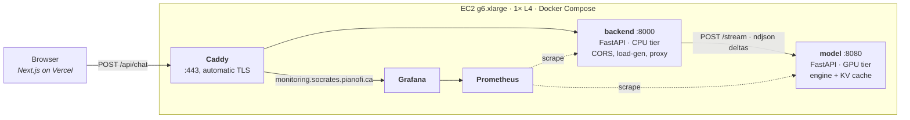
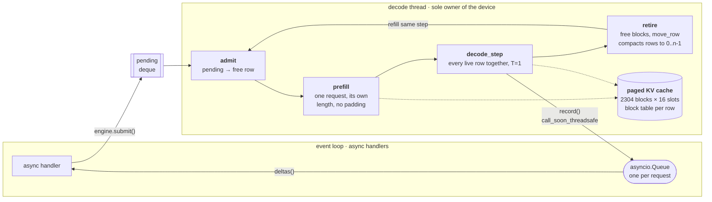

# socrates

An LLM inference engine written from scratch. The Qwen3 architecture is
implemented in plain PyTorch, RoPE, QK-norm, 4:1 GQA, SwiGLU, KV cache, and
serves `MassivDash/Qwen3-4B-heretic` through a continuous-batching
scheduler behind a streaming HTTP API, deployed on a single GPU with Terraform
and instrumented end to end.

No `transformers` modelling code, no vLLM, no TGI in the serving path. vLLM runs
only as a yardstick, on the same box under the same load.

## Results

One L4 (`g6.2xlarge`, 24 GB, ~300 GB/s), Qwen3-4B in bf16, 18 rows × 2048
context, 64 prompts arriving Poisson at 2/s, seed 0. All three measured in one
session, back to back.

| metric | socrates (paged) | socrates (dense) | vLLM 0.29 | paged / vLLM |
|---|---|---|---|---|
| throughput, run average | 243.1 tok/s | 206.1 tok/s | 281.9 tok/s | **86.2%** |
| throughput, median second | 242.0 tok/s | 234.0 tok/s | 312.0 tok/s | 77.6% |
| throughput, peak second | 396.0 tok/s | 342.0 tok/s | 454.0 tok/s | 87.2% |
| per-stream | 21.5 tok/s | 15.8 tok/s | 26.4 tok/s | 81.4% |
| ITL p50 | 46.5 ms | 63.4 ms | 37.9 ms | 1.2× worse |
| TTFT p95 | 11.8 s | 22.7 s | 7.8 s | 1.5× worse |

Decode attention is a hand-written CUDA kernel over a paged KV cache: each row
reads only its own 16-token blocks, and one thread block serves all four query
heads that share a KV head. It streams KV at 82% of the L4's peak bandwidth,
where SDPA over the old shared window managed 39%. That took attention from
~23 ms of a decode step to ~4 ms (`docs/day_8_docs.md`). What is left is
mostly not attention. The 8 GB of weights still go through cuBLAS and Inductor
every step, and prefill is still sequential, which is the whole of the TTFT gap.

## Architecture

Two tiers, split so the GPU tier stays a stateless text-in/text-out service and
everything user-facing — auth, sessions, rate limits — lands on the CPU side
without moving with it.



Inside the GPU tier, one thread owns the device and every HTTP handler is
`async`. A handler never blocks on generation — it waits on a per-request
`asyncio.Queue` that the decode thread fills, which is what keeps `/metrics`
answerable while 18 rows are mid-generation.



A closed tab cancels the handler, which sets `cancelled` on the request; the
next sweep retires the row mid-generation rather than finishing tokens nobody
will read.

Three things in that loop are the whole project:

- **Ragged rows.** `lengths[r]` is per row, so sequences of different lengths
  share one batch with no padding. Each row's KV lives in its own 16-token
  blocks, and the decode kernel reads each row's length on the device and walks
  only that row's blocks. The launch shape depends only on the batch width, so
  one CUDA graph per width covers every context length.
- **Retire and refill.** A finished row is replaced from the queue on the same
  step. `move_row` compacts live rows down so the active block stays packed at
  `0..n-1`; with paging that copies one row of the block table, not the KV.
- **No host sync in the step.** Nothing reads a tensor value back to the CPU
  mid-forward; `lengths` is maintained host-side because the scheduler already
  knows it. One `int(tensor)` per layer would be 36 pipeline stalls per step.

## Stack

| | |
|---|---|
| model | PyTorch — `nn.Linear`, bf16, `torch.compile(mode="reduce-overhead")` on the decode path only; SDPA for prefill, a hand-written CUDA paged-attention kernel (`torch.ops.socrates`) for decode |
| serving | Python, FastAPI — two tiers, ndjson token streaming, httpx streaming proxy |
| frontend | Next.js on Vercel, `fetch` + `ReadableStream` |
| infra | Docker, EC2, Terraform, Prometheus + Grafana |
| analysis | PyTorch profiler, DCGM — roofline arithmetic checked against every measurement |

## Layout

```
model/          GPU tier
  qwen/         the model: RMSNorm, RoPE, GQA attention, SwiGLU, KVCache
    qwen_kv_paged.py  the same model over a paged KV cache (16-slot blocks)
  kernels/      paged decode attention: CUDA kernel + split-K reduce (csrc/),
                PyTorch reference for MPS/CPU and tests, the dispatcher
  paging.py     block allocator, host-side
  inference_cont.py   engine — submit, admit, prefill, decode_step, retire (ENGINE=cont)
  inference_paged.py  the same engine over the paged cache (ENGINE=paged, default)
  inference_static.py static batching, kept as the baseline to beat
  server.py     /generate, /stream, /metrics, /health
backend/        CPU tier — /api/chat, /api/benchmark, Poisson load generator
frontend/       UI
analysis/       roofline arithmetic; layer-by-layer allclose against HuggingFace
bench/          day_2..day_8 harnesses and plots
tests/          pytest; `-m cuda` and `-m weights` run on the GPU host
monitoring/     Prometheus and grafana configs
infra/prod/     Terraform, plus build/profile/kernel/compare scripts for the GPU host
caddy/          Caddyfile for socrates.pianofi.ca + monitoring.socrates.pianofi.ca
docs/           daily writeups
```

## Running it

```bash
make install                 # uv sync + npm install
make dev                     # model :8080, backend :8000, frontend :3000,
                             # prometheus :9090, grafana :3001
```

`make dev` runs the model tier on `DEVICE=mps` by default; set `DEVICE=cuda` on
a GPU host. Weights come from HuggingFace on first boot.

`ENGINE=paged`, the default, serves from the paged KV cache; `ENGINE=cont`
serves from the dense one it replaced. On a Mac the paged engine runs its PyTorch reference attention;
on CUDA it needs the kernel, which the model image builds in its `kernels`
stage and which cannot be built on a laptop.

```bash
make test                                   # laptop-safe; CUDA tests skip themselves
./infra/prod/kernel-on-instance.sh          # build :dev on the GPU host, run the CUDA
                                            # tests and the kernel benchmark there
ENGINES="cont paged" TAG=dev ./infra/prod/compare-vllm.sh   # cont vs paged vs vLLM
```

```bash
make images && make push
cd infra/prod && terraform apply
```
